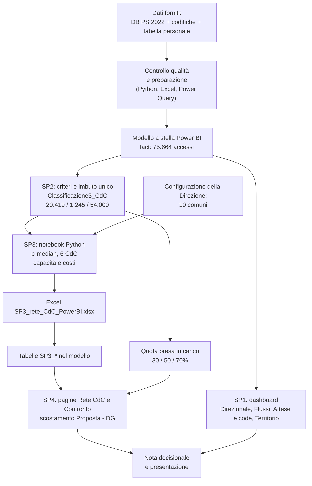

# 01 – Metodo

Questo documento racconta **come abbiamo lavorato**, dalla domanda della Direzione fino alla raccomandazione, e **perché abbiamo fatto certe scelte**.
Ogni passo rimanda al documento che lo spiega in dettaglio.

---

## 1. La domanda

Il caso (LIUC, Project Work 4 «Laboratorio di AI base») chiede al gruppo di fare da team di analisi per la Direzione Strategica di un'azienda sanitaria in provincia di Varese. Le tre domande:

1. **Come sono distribuiti sul territorio i bisogni oggi intercettati dai servizi ospedalieri?**
2. **Quale quota potrebbe essere gestita dalle Case della Comunità (CdC)?**
3. **Come dovrebbe essere configurata una rete territoriale per rispondere a questa domanda, e come si confronta con quella assunta dalla Direzione Generale?**

I dati: gli accessi ai **7 Pronto Soccorso dell'ASST dei Sette Laghi** nel primo semestre 2022 (75.664 accessi).

| Sottoprova | Domanda | Risposta in una riga | Documento |
|---|---|---|---|
| SP0 | Come pianifichiamo il lavoro? | WBS a 4 livelli, 52 attività, 10 giorni, 5.934 € | [09](09-pianificazione-sp0.md) |
| SP1 | Com'è la domanda oggi? | 418 accessi al giorno, attesa mediana 37 min, 87,6% esce verde o bianco | [04](04-kpi-e-misure.md), [08](08-dashboard-pagine.md) |
| SP2 | Quanta domanda potrebbe andare in CdC? | 20.419 accessi (27,0%) compatibili; con quota 50%: circa 10.200 | [06](06-domanda-potenziale-cdc.md) |
| SP3 | Dove aprire le CdC? | 6 CdC (4 hub e 2 spoke), 3,86 M€ l'anno | [07](07-rete-cdc-e-confronto.md) |
| SP4 | Proposta o Direzione? | Proposta: costa 1,41 M€ in meno e gestisce più visite; la DG è più vicina ai pazienti | [07](07-rete-cdc-e-confronto.md) |

---

## 2. Principi di lavoro

1. **Un dato, una fonte, un metodo.** Per ogni numero c'è un solo posto da cui nasce. Esempio: la domanda compatibile è la colonna `Classificazione3_CdC` e basta; la rete SP3 usa lo stesso 20.419, non un altro calcolo.
2. **Un solo modello Power BI** che cresce da SP1 a SP4 (lo chiede la traccia): niente copie parallele.
3. **I file sorgente non si modificano.** Le pulizie stanno in Power Query o in DAX e sono documentate in [03](03-anomalie-e-decisioni.md).
4. **Ogni numero è tracciabile:** file → tabella del modello → colonna → misura. Per questo esistono le tabelle in [02](02-fonti.md) e il [catalogo delle misure](04b-catalogo-misure.md).
5. **Ricalcolo indipendente.** I numeri chiave sono stati ricalcolati fuori da Power BI (Python/pandas sul file Excel originale) e confrontati con il modello.
6. **Dichiarare ipotesi e limiti.** Le ipotesi senza fonte sono marcate **IPOTESI**. I risultati sono **stime teoriche, non effetti causali** (lo chiede la traccia nella SP4).
7. **Codici anomali:** restano nei totali, si nascondono solo dove sarebbero una categoria senza senso.
8. **Prima di ogni modifica grossa si fa una copia di sicurezza** (cartelle `_backup_prima_…`), e le modifiche ripetibili si fanno con script.

---

## 3. Il percorso, in un disegno

---

## 4. SP0 – Pianificazione

Obiettivo, date, team, WBS a 4 livelli, reticolo, budget e indicatori EVM al giorno 5 e all'ultimo giorno. Strumento: file XML aperti in ProjectLibre, generati da script. Dettaglio in [09](09-pianificazione-sp0.md).

---

## 5. SP1 – Flussi e bisogni

### 5.1 Esplorazione e qualità dei dati
Prima di costruire il modello abbiamo controllato struttura e qualità del file originale: valori mancanti, duplicati, date fuori periodo, durate negative, codici non decodificabili, incoerenze (per esempio sesso diverso per lo stesso paziente, ticket non coerente con il regime). Gli esiti, con numeri e decisioni, sono in [03](03-anomalie-e-decisioni.md).

### 5.2 Preparazione
- Il DB originale è stato ridotto e arricchito in un file `fatti_ridotta.xlsx` (data-ora complete, durata, indicatore del ticket). Il sesso e l'anno di nascita sono passati in `pazienti.xlsx` (un paziente = una riga, sesso = ultimo registrato).
- In **Power Query**: tipi dei campi; ordinamento per data-ora di arrivo e indice dell'episodio; data-ora della presa in carico; durate (attesa, permanenza, presa in carico → dimissione); ore intere; chiavi dei turni (`<PS>-M|P|N`); criterio «durata ≤ 2 ore».
- **Decodifiche**: un file Excel con un foglio per ogni codice (triage, esito, arrivo, regime, ticket, reparti, fasce d'età, fasce orarie…) e colonne di raggruppamento utili ai grafici. Dove il PDF dei codici non bastava (per esempio i colori del triage) lo abbiamo dichiarato nella colonna `Fonte`.

### 5.3 Modello a stella
Un fatto (l'accesso) e le dimensioni di decodifica, con tre copie del calendario, delle fasce orarie e dei turni (arrivo, presa in carico, dimissione). Il valore economico è un semplice `SUM`. Le misure stanno in una tabella dedicata `_Misure`. Dettaglio in [05](05-modello-dati.md).

### 5.4 Come si calcolano i tempi
- **Attesa** = data-ora presa in carico − data-ora arrivo.
- **Permanenza** = data-ora dimissione − data-ora arrivo. Gli accessi senza dimissione (1.526) sono esclusi; restano nei volumi.
- Si riportano **mediana e 90° percentile**, in minuti, per triage in ingresso e fascia oraria. La media da sola non è accettata dalla traccia e sarebbe fuorviante (4.845 permanenze oltre le 24 ore).
- **Pazienti presenti per ora:** per ogni giorno e per ogni ora si contano gli accessi arrivati prima della fine dell'ora e non ancora dimessi; poi si fa la media per giorno della settimana × ora (matrice) e si calcola anche il 90° percentile.

### 5.5 Codici bianchi e ticket
- Si usa il **triage in uscita**. Codici bianchi: 5.304 (7,0%).
- **Ticket stimato** = codici bianchi × 25 € = 132.600 €. **Ticket registrato** = importo nel flusso = 51.850 €. Le due cifre sono tenute separate e la differenza è mostrata (80.750 €). È una stima della compartecipazione alla spesa, **non** il costo dell'accesso.

### 5.6 La dashboard
Quattro pagine più il Leggimi, come chiede la traccia, con il destinatario nel sottotitolo. Regole: un titolo che dice l'insight, numeri formattati con unità, colore solo per evidenziare, niente 3D, assi in ordine logico, al massimo 6 KPI per pagina e nessun KPI ripetuto. Descrizione in [08](08-dashboard-pagine.md). Definizione dei KPI in [04](04-kpi-e-misure.md).

---

## 6. SP2 – Domanda potenziale

1. **Fonti** per i criteri: documento del corso, DM 77/2022, AGENAS ([02](02-fonti.md)).
2. **Criteri → regole:** sei criteri (diagnosi primaria, triage in ingresso e in uscita, esito, durata presa in carico → dimissione ≤ 2 ore, diagnosi secondaria), ognuno una colonna `Compatibile_CdC` TRUE / FALSE / vuota.
3. **Tre classi** con una colonna calcolata unica: un criterio falso → *non compatibile*; nessun falso ma uno vuoto → *non classificabile*; altrimenti *potenzialmente compatibile*. I dati mancanti **non** si danno per soddisfatti.
4. **Due misure:** domanda compatibile (20.419) e domanda presa in carico (quota × compatibili), con la quota dichiarata come ipotesi e giustificata sui dati (81% decide da solo e arriva con mezzi propri; 49,9% anche negli orari di una CdC spoke).
5. **Pagina** «Domanda potenziale» per mese e per comune, con criteri e quota.

Dettaglio, numeri e limiti in [06](06-domanda-potenziale-cdc.md).

## 7. SP3 – Rete CdC

Fatta in **Python** (notebook) perché serve un modello di ottimizzazione che Power BI non offre. In 5 passi: domanda compatibile per comune → territorio (107 comuni che usano i nostri PS) → distanze (linea d'aria × 1,3 tra i centroidi ISTAT) → **p-median esatto** (HiGHS) con vincoli (max 10, Varese sempre, sedi in comuni ≥ 5.000 abitanti, nessun comune oltre 15 km) → per ogni CdC orari (DM 77), personale, capacità e costi. Il numero di CdC è **la rete più piccola con almeno il 90% della domanda entro 10 km**: 6.
Il notebook scrive un Excel che Power BI legge: così domanda e KPI restano nello stesso modello. Dettaglio in [07](07-rete-cdc-e-confronto.md).

## 8. SP4 – Confronto con la Direzione Generale

- La configurazione della DG (10 comuni) è stata valutata **con le stesse regole** della nostra: stessa domanda, stessa assegnazione (CdC più vicina), stesse regole hub/spoke, orari, personale e costi.
- Tabella di assegnazione con colonna **Scenario** («Proposta» / «Direzione Generale»): filtrando lo scenario ogni misura si calcola per l'una o l'altra rete.
- **Scostamento = Proposta − DG** in evidenza nella pagina «Confronto».
- **Matrice multidimensionale** (accessibilità, capacità, impatto sul PS, economia, equità) e **sensibilità** (quota 30/50/70%, 7–10 CdC, sedi per popolazione, hub 8–20…).
- **Nota decisionale:** prima frase = raccomandazione e condizioni; tre evidenze dalla dashboard; il metodo sta nel Leggimi.
- La distinzione **tariffa ≠ costo di funzionamento ≠ risparmio** è mantenuta: il «valore PS non erogato» è una tariffa, non un risparmio.

## 9. Come controlliamo i numeri

| Controllo | Come |
|---|---|
| Totali del modello = file originale | 75.664 accessi, 58.320 pazienti, 9.840.639,33 €, 1.526 senza dimissione, 5.304 bianchi: ricalcolati con Python dal foglio `PS_2022` e con misure DAX |
| Tempi | Mediana e 90° percentile di attesa e permanenza ricalcolati da data e ora originali: 37 / 203 min e 178 / 1.049 min |
| Anomalie | Ogni conteggio di [03](03-anomalie-e-decisioni.md) ricalcolato in due modi |
| Domanda per rete SP3 = notebook | Per tutte le 16 CdC la misura `SP3 Domanda compatibile rete` coincide con il notebook (16.177 nella Proposta) |
| Funnel | I 3 insiemi (compatibile + non classificabile + non compatibile) sommano a 75.664 |
| Piano SP0 | Verifica indipendente degli XML; formule Excel ricalcolate |

## 10. Strumenti

Power BI Desktop (Power Query, DAX), Excel, **Python** (pandas, numpy, scipy con solver HiGHS, geopandas, matplotlib), notebook Jupyter, **ProjectLibre** (SP0), Git. Elenco dei limiti e di cosa serve per ripetere tutto in [10](10-limiti-e-riproducibilita.md).

**Torna all'[indice](README.md).**
