# 05 – Modello dati e data dictionary

La traccia chiede una «breve documentazione dei dati e delle variabili utilizzate».
Questo documento descrive il **modello a stella** di Power BI (`PW4 15`): la tabella dei fatti, le dimensioni, le relazioni, e cosa significa ogni campo.

Numeri del modello al 18/11/2026: **75.664 accessi**, 58.320 pazienti, 7 PS, 1.379 comuni di residenza, 181 giorni con dati (01/01–30/06/2022).

---

## 1. Schema a stella

```mermaid
erDiagram
    Fact_PS_2022 }o--|| DIm_Pazienti : "FK_Paziente"
    Fact_PS_2022 }o--|| Dim_Pronto_Soccorso : "FK_Codice_Identificativo_PS"
    Fact_PS_2022 }o--|| Dim_Comuni_Residenze : "FK_Codice_Comune_Residenza (ISTAT 6 cifre)"
    Fact_PS_2022 }o--|| DIm_Diagnosi_Primaria : "FK_Codice_Diagnosi_Primaria"
    Fact_PS_2022 }o--|| DIm_Diagnosi_Secondaria : "FK_Codice_Diagnosi_Secondaria"
    Fact_PS_2022 }o--|| Dim_Triage_Ingresso : "triage_ingresso"
    Fact_PS_2022 }o--|| Dim_Triage_Uscita : "triage_uscita"
    Fact_PS_2022 }o--|| Dim_Esito_Trattamento : "FK_Esito_Trattamento"
    Fact_PS_2022 }o--|| Dim_Mod_Arrivo : "FK_Codice_Mod_Arrivo"
    Fact_PS_2022 }o--|| Dim_Calendario_Accettazione : "data_accettazione"
    Fact_PS_2022 }o--|| Dim_Calendario_Prcar : "data_prcar"
    Fact_PS_2022 }o--|| Dim_Calendario_Dimissione : "data_dimissione"
    Fact_PS_2022 }o--|| DIm_Fasce_Orarie_Accetazionee : "ora_intera_accettazione"
    Fact_PS_2022 }o--|| Dim_Turni_Accettazione : "FK_PS_Turno_Accettazione"
    DIm_Pazienti }o--|| Dim_Fasce_Eta : "anni_compiuti_2022"
```



*Il disegno mostra le relazioni principali.* Mancano per semplicità: paesi di cittadinanza, reparti, problema principale, regime, responsabile invio, ticket, le fasce orarie e i turni di presa in carico e dimissione (stessa logica delle fasce e turni di accettazione).

**Una fact, tante dimensioni.** Il «fatto» è l'accesso al PS. Numero e valore delle prestazioni sono già colonne dell'accesso, quindi il valore economico è un semplice `SUM` (lo chiede la traccia).

**Tre calendari, tre fasce orarie, tre tabelle dei turni.** Un accesso ha tre momenti (arrivo, presa in carico, dimissione). Per ciascuno c'è una copia della dimensione, tutte con relazione **attiva**, senza `USERELATIONSHIP`. I KPI di default usano sempre l'**arrivo** (`…_Accettazione`).

### Relazioni

Il modello ha 42 relazioni: **29 volute** e 13 automatiche create da Power BI per la gerarchia date/ora (`LocalDateTable_…`).

- 15 relazioni dalla fact verso paziente, PS, comune, paese di cittadinanza e dimensioni di decodifica (triage in ingresso e in uscita, esito, arrivo, problema, responsabile invio, regime, ticket, reparto, diagnosi primaria e secondaria): molti-a-uno.
- 3 verso i calendari, 3 verso le fasce orarie, 3 verso i turni del personale.
- `DIm_Pazienti[anni_compiuti_2022]` → `Dim_Fasce_Eta[Eta]`: l'età del paziente decide la fascia.
- `SP3_Assegnazione`, `SP3_CdC`, `SP3_Scenari` → `SP3_Rete[Scenario]`: il filtro «Proposta / Direzione Generale». `SP3_Assegnazione` **non** ha una relazione con i comuni: il legame passa dalla misura `SP3 Domanda compatibile rete`, che usa `TREATAS` sul codice ISTAT.
- `Dim_Turni_Accettazione[codice_istituto]` → `Tab_Presenti_Ora_Istituto[Istituto]`: molti-a-molti.
- **Filtro bidirezionale** su 9 relazioni (PS, paesi, fasce orarie di accettazione, problema principale, regime, responsabile invio, ticket, triage in ingresso, fasce d'età). Funziona, ma è un punto da controllare se si aggiungono visual (rischio di ambiguità).

---

## 2. Tabella dei fatti – `Fact_PS_2022`

Una riga = un accesso al PS (un «episodio»). **75.664 righe.**

### 2.1 Campi che arrivano dal flusso originale

| Campo nel modello | Campo originale | Significato | Note e anomalie |
|---|---|---|---|
| `PK_ID_Episodio` | – (creato) | Numero progressivo dell'accesso (1…75.664) | Assegnato dopo aver ordinato per data-ora di arrivo |
| `FK_Codice_Identificativo_PS` | `codice_istituto` | Pronto Soccorso che ha registrato l'accesso | 7 valori; vedi tabella sotto |
| `FK_Paziente` | `id_pz` | Paziente (id anonimo `SIMP…`) | 58.320 distinti; il massimo per paziente è 39 accessi |
| `FK_Paese_Cittadinanza` | `cittadinanza` | Codice cittadinanza (ANPR) | 129 codici; 100 = Italia (68.710 accessi); poi Marocco 436 (1.202), Albania 201 (1.106), Ucraina 243 (527) |
| `FK_Codice_Comune_Residenza` | `residenza` | **Codice ISTAT del comune di residenza** (testo, 6 cifre) | 9 vuoti, 13 «Non trovato» → [03](03-anomalie-e-decisioni.md) |
| `data_accettazione`, `ora_accettazione` | `data`, `ora` | Data e ora di arrivo (accettazione) | Mai vuoti |
| `FK_Codice_Mod_Arrivo` | `mod_arr` | Modalità di arrivo | 9 = non rilevato (1.747) |
| `FK_Codice_Responsabile_Invio` | `resp_inv` | Chi ha inviato il paziente | 1 accesso con codice 0 non previsto |
| `FK_Codice_Problema_Principale` | `probl_pr` | Problema principale (31 codici) | 72 vuoti |
| `triage_ingresso` | `triage_ingresso` | Codice di triage all'arrivo: R, G, V, B, N | 153 vuoti |
| `data_prcar`, `ora_prcar` | `data_prcar`, `ora_prcar` | Data e ora di **presa in carico** | Mai vuoti |
| `FK_Esito_Trattamento` | `esito_tratt` | Esito del trattamento | 8 valori presenti su 10 |
| `data_dimissione`, `ora_dimissione` | `data_dim`, `ora_dim` | Data e ora di dimissione | **1.526 vuoti** |
| `triage_uscita` | `triage_uscita` | Codice di triage alla fine del percorso | 153 vuoti. **I codici bianchi e il ticket si leggono qui** (traccia) |
| `FK_Codice_Reparto` | `codrep` | Reparto di ricovero | Valorizzato solo con esito = ricovero (10.295) |
| `FK_Codice_Regime_Erogazione` | `reg_erog` | Regime di erogazione (SSN, SSN + ticket, …) | |
| `FK_Codice_Ticket` | `tck` | Ticket applicato: 0 oppure 2500 (= 25,00 €) | 2.074 accessi con ticket |
| `FK_Codice_Diagnosi_Primaria` | `diagn_pr` | Diagnosi principale (ICD-9-CM) | 1.541 vuoti |
| `FK_Codice_Diagnosi_Secondaria` | `diagn_sec` | Diagnosi secondaria (ICD-9-CM) | Vuota nel 92,5% (facoltativa) |
| `Numero_prestazioni_PS` | idem | Prestazioni erogate nell'accesso | Totale 860.628 |
| `Valore_economico_prestazioni_PS` | idem | Valore in € delle prestazioni (tariffa) | Totale 9.840.639,33 € |

I 7 PS (`codice_istituto`):

| Codice | PS | Accessi |
|---|---|---:|
| 3090101 | Varese – PS generale Circolo | 23.705 |
| 30010 | Tradate – PS Galmarini | 16.398 |
| 3028201 | Cittiglio – PS Luvini | 10.851 |
| 3090102 | Varese – PS pediatrico Del Ponte | 8.009 |
| 3028202 | Luino – PS Onfalonieri | 6.346 |
| 30003 | Varese – PS ostetrico-ginecologico Del Ponte | 5.221 |
| 30012 | Angera – PS Ondoli | 5.134 |

### 2.2 Campi derivati in Power Query (preparazione)

| Campo | Come si calcola | A cosa serve |
|---|---|---|
| `data_ora_accettazione`, `data_ora_dimissione` | Data + ora (preparate nel file `fatti_ridotta`) | Calcolo dei tempi |
| `data_ora_prcar` | `data_prcar` + `ora_prcar` | Calcolo dei tempi |
| `durata_accettazione_dimissione` | Dal campo di testo `durata_pronto_soccorso` («N days hh:mm:ss»), convertito in durata | **Permanenza** (arrivo → dimissione) |
| `durata_accettazione_prcar` | `data_ora_prcar − data_ora_accettazione` | **Attesa** (arrivo → presa in carico) |
| `durata_prcar_dimissione` | `data_ora_dimissione − data_ora_prcar` | Criterio di compatibilità CdC |
| `ora_intera_accettazione`, `…_prcar`, `…_dimissione` | Ora del giorno, 0–23 | Collegamento alle fasce orarie |
| `FK_PS_Turno_Accettazione`, `…_Prcar`, `…_Dimissione` | `<codice PS>-<turno>`, con turno **M** se l'ora è 7–13, **P** 14–20, **N** altrimenti | Collegamento alla tabella del personale |
| `Ticket_pagato` | TRUE per gli accessi con ticket (2.074) | Lettura del ticket |
| `Compatibile_CdC_Durata_Prestazione` | `durata_prcar_dimissione ≤ 2 ore`; vuoto se manca la dimissione | Criterio di compatibilità CdC |
| `data_accettazione _numerica` | Copia numerica della data di arrivo | Supporto ai calcoli |

Le durate sono salvate come **frazioni di giorno** (formato durata). Le misure le moltiplicano per **1.440** per avere i minuti (`ROUND(MEDIAN(…) * 1440, 0)`).

### 2.3 Colonne calcolate in DAX (compatibilità CdC)

| Colonna | Valori | Regola |
|---|---|---|
| `Classificazione3_CdC` | «Potenzialmente compatibile» (20.419), «Non classificabile» (1.245), «Non compatibile» (54.000) | **Il metodo unico della domanda potenziale**: vedi [06](06-domanda-potenziale-cdc.md) |
| `Episodio_Compatibile_CdC` | TRUE / FALSE | `Classificazione3_CdC = "Potenzialmente compatibile"`. Vista TRUE/FALSE per i grafici esistenti |
| `Filtro CdC` | «Solo accessi compatibili CdC» / «Altri accessi» | Alimenta il pulsante on/off presente in 4 pagine |

---

## 3. Le dimensioni

| Tabella | Chiave | Righe | Colonne principali | Note |
|---|---|---:|---|---|
| `DIm_Pazienti` | `PK_Paziente` | 58.320 | `sesso`, `sesso_descrizione`, `anno_nascita`, `anni_compiuti_2022` | Età = 2022 − anno di nascita. Sesso = ultimo registrato |
| `Dim_Pronto_Soccorso` | `PK_Codice_Identificativo_PS` | 7 | Denominazione, comune, indirizzo, azienda, coordinate | `Latitudine corretta` e `Longitudine corretta` (regola in [03](03-anomalie-e-decisioni.md)) |
| `Dim_Comuni_Residenze` | `PK_Codice_Comune` | 1.379 | `Comune`, `Provincia`, `Regione`, `Ripartizione geografica`, `Popolazione_2022` | Solo i comuni presenti nei dati. 812 accessi sono «Estero» |
| `Dim_Paesi_Cittadinanze` | `PK_Codice_Paese` | 129 | `Paese_ANPR` | |
| `DIm_Diagnosi_Primaria` | `PK_Codice_Diagnosi` | 16.228 | `Descrizione`, `Categoria` (capitolo ICD-9-CM), `Compatibile_CdC` | `Compatibile_CdC` = TRUE per 8.518 codici, FALSE per 7.710 |
| `DIm_Diagnosi_Secondaria` | `PK_Codice_Diagnosi` | 16.228 | idem | Stessa tabella della primaria, caricata due volte |
| `Dim_Esito_Trattamento` | `PK_Esito_Trattamento` | 10 | `Etichetta_breve`, `Gruppo_esito`, `Compatibile_CdC` | Compatibili: 1, 6, 7, 8 |
| `Dim_Triage_Ingresso`, `Dim_Triage_Uscita` | `Codice` | 6 | `Colore`, `Significato`, `Gruppo`, `Ordine`, `Compatibile_CdC` | Compatibili: V e B. `Colore` è ordinato per `Ordine` (R, G, V, B, N, ND) |
| `Dim_Mod_Arrivo` | `PK_Codice_Mod_Arrivo` | 8 | `Etichetta_breve`, `Gruppo_arrivo` | Autonomo / Mezzo di soccorso / Non rilevato |
| `Dim_Problema_Principale` | `PK_Codice_Problema_Principale` | 31 | `Descrizione` | |
| `Dim_Regime_Erogazione` | `PK_Codice_Regime_Erogazione` | 4 | `Etichetta_breve` | |
| `Dim_Responsabile_Invio` | `PK_Codice_Responsabile_Invio` | 9 | `Etichetta_breve` | |
| `Dim_Reparti` | `PK_Codice_Reparto` | 72 | `Descrizione` | |
| `Dim_Ticket` | `PK_Codice_Ticket` | 2 | `Importo_eur` | 0 € e 25 € |
| `Dim_Fasce_Eta` | `Eta` | 111 | `Fascia_eta` (ordinata), `Classe` | Una riga per età 0–110 |
| `DIm_Fasce_Orarie_*` (3) | `Ora` | 24 | `Etichetta_ora`, `Turno` (M/P/N), `Turno_descrizione`, `Fascia` | M 7–14, P 14–21, N 21–7 (allineate ai turni del personale) |
| `Dim_Calendario_*` (3) | `Data` | 212 | Anno, trimestre, mese, giorno della settimana, `Festivo`, `Tipo_giorno`, `In_periodo_dati` | Mesi e giorni ordinati con «Ordina per colonna». Dal 01/01 al 31/07; i dati vanno fino al 30/06 |
| `Dim_Turni_*` (3) | `PK_PS_Turno` | 21 | `Medici`, `Infermieri`, `OSS`, `Totale_Personale`, orari del turno | 7 PS × 3 turni |

**Valori della tabella dei turni (dalla traccia, professionisti presenti contemporaneamente):**

| PS | Medici M/P/N | Infermieri M/P/N | OSS M/P/N |
|---|---|---|---|
| 3090101 Varese Circolo | 5 / 4 / 3 | 11 / 11 / 9 | 6 / 6 / 6 |
| 30010 Tradate | 2 / 2 / 2 | 5 / 5 / 4 | 2 / 2 / 1 |
| 3028201 Cittiglio | 1 / 1 / 1 | 4 / 5 / 3 | 2 / 1 / 1 |
| 3028202 Luino | 1 / 1 / 1 | 4 / 3 / 2 | 1 / 1 / 1 |
| 30012 Angera | 1 / 1 / 1 | 3 / 2 / 2 | 1 / 1 / 0 |
| 30003 e 3090102 Varese Del Ponte | 2 / 2 / 2 | 6 / 6 / 4 | 3 / 2 / 2 |

---

## 4. Tabelle di supporto e tabelle calcolate

| Tabella | Origine | Scopo |
|---|---|---|
| `_Misure` | Solo misure | Contiene le misure con nomi comprensibili (tranne le 10 nelle tabelle di supporto). Vedi il [catalogo](04b-catalogo-misure.md) |
| `FNL_Fasi` | DAX | Le fasi del funnel «da 75.664 a 20.419» |
| `Scenario CdC` | DAX | 6 scenari di quota presa in carico: 0, 30, 50, 70, 100%, e 70% + 30% dei non classificabili |
| `Quota CdC passi` | DAX | I tre passi che giustificano la quota base del 50% |
| `Ore_presenza` | DAX | 4.344 righe = 181 giorni × 24 ore (griglia per il 90° percentile dei presenti) |
| `Tab_Presenti_Ora` | DAX | Pazienti presenti per giorno della settimana × ora (168 righe) |
| `Tab_Presenti_Ora_Istituto` | DAX | Presenti, in coda e personale per PS × giorno × ora (1.176 righe) |
| `SP3_*` (6 tabelle) | Excel del notebook | Rete CdC, assegnazione comune → CdC, scenari (vedi [07](07-rete-cdc-e-confronto.md)) |

### Come si calcolano i pazienti presenti per ora

La traccia: «un paziente è presente in un'ora se è arrivato prima della fine di quell'ora e non è ancora stato dimesso».
Per ogni giorno del periodo e per ogni ora, il modello conta le righe con:

```
data_ora_accettazione < fine dell'ora   E   data_ora_dimissione > inizio dell'ora
```

Poi fa la **media sui giorni** con lo stesso giorno della settimana e la stessa ora. La media da sola non è accettata dalla traccia, quindi esiste anche il 90° percentile (`Pazienti presenti (P90)`). Gli accessi senza dimissione non entrano nel conteggio.

Risultato: il massimo è il lunedì tra le 11 e le 16 (circa 174 pazienti), il minimo la domenica all'alba (84).

---

**Torna all'[indice](README.md).**
