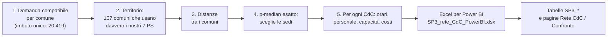

# 07 – Rete delle Case della Comunità e confronto con la Direzione Generale (SP3 e SP4)

Questo documento spiega **dove aprire le CdC, con quale metodo, con quali ipotesi e costi**, e **come la nostra rete si confronta con quella della Direzione Generale (DG)**.

**Risultato in breve** (quota presa in carico 50%):

| | **Proposta (SP3)** | **Direzione Generale (SP4)** | Proposta − DG |
|---|---:|---:|---:|
| CdC (di cui hub) | **6** (4) | **10** (4) | −4 |
| Km medi dalla CdC | 4,97 | 3,97 | +1,00 |
| Domanda entro 10 km | 93,2% | 99,3% | −6,1 punti |
| Visite gestite all'anno | **15.310** | 13.967 | +1.343 |
| Riduzione degli accessi PS | 10,0% | 9,2% | +0,9 punti |
| Costo annuo di funzionamento | **3,86 M€** | 5,27 M€ | −1,41 M€ |
| Costo per visita gestita | **252 €** | 378 € | −125 € |

Il codice è nel notebook `SP3_rete_CdC/SP3_rete_CdC.ipynb` (Python). Le tabelle sono lette da Power BI dal file `SP3_rete_CdC_PowerBI.xlsx` (vedi [02](02-fonti.md), punto 2.3).

---

## 1. Il metodo in 5 passi

**Obiettivo del modello:** scegliere dove aprire al massimo 10 CdC in modo che sia minima la **distanza media dei pazienti**, pesata per la domanda compatibile.

**Perché il p-median.** È il modello classico per i servizi sanitari di base (Hakimi 1964; ReVelle e Swain 1970). Dà direttamente la tabella *comune → CdC* chiesta dalla traccia. Ha una soluzione **esatta** in meno di un secondo, quindi chiunque lo rilancia ottiene lo stesso risultato. Il k-means non rispetta i vincoli e può mettere la sede in un lago o in un bosco.

---

## 2. Domanda e territorio

**Domanda.** È l'imbuto unico della SP2: gli accessi con `Classificazione3_CdC` = «Potenzialmente compatibile» (20.419), contati per comune di residenza. Il file `prepara_dati.py` la estrae da `Fact_Finale_PowerBI.xlsx` (colonna `Episodio_Compatibile_CdC`).

**Annualizzazione.** I dati coprono 181 giorni: annuo = semestre × 365/181 = × 2,0166. Gli accessi PS annui sono 152.564.

**Territorio del progetto.** Un comune della provincia di Varese è nel territorio se fa **almeno 50 accessi ai nostri PS ogni 1.000 abitanti** (nel semestre).
- Risultato: **107 comuni**, 458.148 abitanti, **16.177 accessi compatibili** (79% del totale).
- Il sud della provincia (Busto, Gallarate, Saronno) va in un'altra ASST: Busto ha 82.754 abitanti ma solo 339 accessi da noi. Non è territorio del progetto.

**Domanda esterna** (comuni fuori dal territorio, incluso l'estero): **4.242 accessi compatibili nel semestre**. Non sceglie le sedi, ma la misuriamo: la attribuiamo alla CdC del PS che quelle persone usano oggi (per esempio, Mozzate → PS di Tradate → CdC di quel bacino). Serve solo a vedere se la capacità basterebbe anche per loro.

**Comuni fusi.** Un comune con più codici ISTAT è un solo comune: le domande si sommano. La tabella `SP3_Assegnazione` ha però una riga per codice ISTAT (230 righe in tutto), così il collegamento con il modello passa dal codice a 6 cifre.

---

## 3. Distanze e modello

**Distanza:** linea d'aria tra i centri dei comuni (centroide dei poligoni ISTAT, calcolato in metri nel sistema UTM 32N) × **1,3** (stima della strada). **Tempo:** a 45 km/h.

**Il modello, in parole.** Tra i comuni candidati (almeno 5.000 abitanti) il modello sceglie **k sedi** e manda ogni comune alla sua sede, in modo che sia minima la somma «domanda × km».

| Elemento | Scelta |
|---|---|
| Variabili | Sede aperta sì/no per ogni candidato; assegnazione di ogni comune a una sede |
| Obiettivo | Minimizzare la somma, sui comuni, di (domanda + 0,0001) × km dalla sede assegnata. Il +0,0001 serve solo a far assegnare alla sede più vicina anche i comuni senza domanda |
| Vincoli | Ogni comune va a **una sola** sede aperta; si possono aprire esattamente `k` sedi; **Varese** è sempre una sede; sedi solo in comuni con ≥ 5.000 abitanti; nessun comune a più di **15 km** dalla sua sede |
| Solutore | Programmazione lineare intera esatta (HiGHS, `scipy.optimize.milp`) |
| Output | Sedi scelte e bacini (comune → CdC) |

### Quante CdC? La rete più piccola che rispetta lo standard

Ogni sede costa anche con pochi pazienti, perché il personale deve essere presente per tutta l'apertura. Si prova ogni `k` da 1 a 10 e si sceglie **il più piccolo `k` con almeno il 90% della domanda entro 10 km**.

| CdC (k) | Km medi | Domanda entro 10 km | Km max | Sedi |
|---:|---:|---:|---:|---|
| 5 | 6,38 | 77,1% | 14,8 | Besozzo, Lavena Ponte Tresa, Luino, Sumirago, Varese |
| **6** | **4,97** | **93,2%** | **13,2** | **Besozzo, Castiglione Olona, Lavena Ponte Tresa, Luino, Sesto Calende, Varese** |
| 7 | 4,52 | 93,2% | 13,2 | Le 6 sedi + Tradate |
| 8 | 4,12 | 95,6% | 12,7 | Le 7 sedi + Arcisate |
| 9 | 3,79 | 97,0% | 12,7 | Le 8 sedi + Gavirate |
| 10 | 3,47 | 98,0% | 12,7 | Arcisate, Besozzo, Castronno, Gavirate, Lavena Ponte Tresa, Luino, Sesto Calende, Tradate, Varese, Vedano Olona |

Con 5 sedi si arriva al 77%: aggiungendo la sesta si guadagnano **16 punti**. Oltre la sesta il guadagno è piccolo.

> **Attenzione.** Il numero 6 dipende dalla soglia «90% entro 10 km», che è una **nostra ipotesi**. Con la soglia al 95% sarebbero 8 sedi (tabella sopra).

---

## 4. La rete proposta

**6 CdC: 4 hub aperte h24 e 2 spoke.** Hub = bacino di almeno 40.000 abitanti (DM 77/2022).

| CdC | Tipo | Orario | Domanda teorica (annua) | In orario | Presa in carico (50%) | Capacità | Saturazione | Costo annuo | €/visita |
|---|---|---|---:|---:|---:|---:|---:|---:|---:|
| Varese | Hub | 0–24, 7/7 | 8.780 | 8.780 | 4.390 | 22.277 | 19,7% | 790.072 € | 180 |
| Castiglione Olona | Hub | 0–24, 7/7 | 8.324 | 8.324 | 4.162 | 22.277 | 18,7% | 790.072 € | 190 |
| Besozzo | Hub | 0–24, 7/7 | 7.195 | 7.195 | 3.598 | 22.277 | 16,1% | 790.072 € | 220 |
| Sesto Calende | Hub | 0–24, 7/7 | 2.880 | 2.880 | 1.440 | 22.277 | 6,5% | 790.072 € | 549 |
| Luino | Spoke | 8–20, 6/7 | 2.797 | 1.833 | 917 | 9.547 | 9,6% | 352.169 € | 384 |
| Lavena Ponte Tresa | Spoke | 8–20, 6/7 | 2.646 | 1.607 | 804 | 9.547 | 8,4% | 352.169 € | 438 |
| **Totale** | | | **32.622** | | | **108.202** | | **3.864.624 €** | **252** |

**Come si legge:** *domanda teorica* = tutti gli accessi compatibili del bacino in un anno → *in orario* = quelli arrivati quando la CdC è aperta → *presa in carico* = × quota 50% → *gestita* = non più della capacità. La gestita totale è **15.310** (la presa in carico è sempre sotto la capacità).

Dettagli del bacino (distanza dei 107 comuni): 0–5 km il **46,3%** della domanda, 5–10 km il **46,9%**, 10–15 km il **6,8%**; nessuno oltre 15 km. Il comune più lontano dalla sua CdC è a 13,2 km.

Le mappe: `SP3_rete_CdC/output/mappa_bacini.png` e `mappa_confronto.png` (stella = hub, croce = spoke, quadrato = PS, grigio = fuori territorio).

---

## 5. Servizi, orari, personale, capacità e costi

**Servizi assunti** (documento del corso, par. 3): medicina generale per bisogni non urgenti e a bassa complessità; assistenza infermieristica ambulatoriale; controlli di condizioni croniche stabili; prestazioni di base programmate (prelievi, ECG).

**Orari** (DM 77/2022): hub h24 7 giorni su 7; spoke 8–20, 6 giorni su 7.

**Personale.** In ogni ora di apertura **1 medico e 1 infermiere**; più medici se l'ora di punta lo richiede:
`medici = max(1, arrotonda_su(picco_di_accessi_presi_in_carico_in_un'ora / (3 × 0,85)))`.
In tutte le sedi esce **1 medico**. Amministrativi: 2 per hub, 1 per spoke.

**Capacità** (visite/anno) = ore di apertura × medici × **3 visite/ora** × **85%**.
- Hub: 8.736 ore × 1 × 3 × 0,85 = **22.277** visite.
- Spoke: 3.744 ore × 1 × 3 × 0,85 = **9.547** visite.

**Gestita** = il minore tra presa in carico e capacità.

**Costo annuo di funzionamento** (i costi di istituzione sono esclusi, come chiede la traccia):

`costo = ore × medici × 38,72 €  +  (ore × medici / 1.500 + amministrativi) × 44.965,97 €  +  costo della sede`

| Voce | Hub | Spoke | Fonte |
|---|---:|---:|---|
| Medico (38,72 €/ora) | 338.258 € | 144.968 € | ACN 2026 |
| Infermieri (5,82 FTE hub, 2,50 FTE spoke × 44.965,97 €) | 261.882 € | 112.235 € | RGS 2024 + oneri 33% (ipotesi) |
| Amministrativi (2 hub, 1 spoke × 44.965,97 €) | 89.932 € | 44.966 € | Ipotesi |
| Sede (utenze, pulizie, manutenzione) | 100.000 € | 50.000 € | **Ipotesi senza fonte** |
| **Totale** | **790.072 €** | **352.169 €** | |

Totale della rete: 4 × 790.072 + 2 × 352.169 = **3.864.624 €**.

Il «**valore PS non erogato**» (1,14 M€) è la **tariffa** delle prestazioni PS delle visite gestite. **Non è un risparmio**: la traccia chiede di tenere distinti valorizzazione tariffaria, costi di funzionamento e risparmi teorici.

> **Capacità e domanda.** La capacità è molto più alta della domanda deviabile (saturazione tra il 6% e il 20%): una CdC aperta deve avere almeno un medico anche con pochi pazienti. La capacità libera serve ad altre attività della CdC (cronicità, prevenzione) che il modello non considera. Per questo conviene **non aprire più sedi del necessario**.

---

## 6. SP4 – Confronto con la Direzione Generale

**La configurazione della DG** (documento «Sottoprova 4 – CdC Direzione»): il testo dice 9 CdC, ma elenca **10 comuni**: Angera, Arcisate, Azzate, Cuasso al Monte, Gavirate, Laveno-Mombello, Luino, Sesto Calende, Tradate, Varese. Le valutiamo tutte e 10. Sedi in comune con la nostra proposta: **Luino, Sesto Calende, Varese**.

**Criteri omogenei** (la traccia lo richiede): stessa domanda, stesso territorio, stessa assegnazione (**ogni comune va alla CdC più vicina**), stesse regole hub/spoke (hub se il bacino ha ≥ 40.000 abitanti), stessi orari, personale e costi. Le informazioni mancanti per la DG sono integrate con le nostre ipotesi. Così le differenze dipendono solo da **dove** stanno le sedi.

**Nel modello Power BI.**
- `SP3_Assegnazione` è la **tabella di assegnazione** chiesta dalla traccia: per ogni codice ISTAT e per ogni rete, la CdC di riferimento, con la colonna **Scenario** («Proposta» / «Direzione Generale»).
- La domanda per rete e per CdC **non arriva dal notebook**: la misura `SP3 Domanda compatibile rete` la calcola con `Accessi compatibili CdC` e `TREATAS` sui codici ISTAT. Controllo: coincide con il notebook per tutte le 16 CdC (per la Proposta, 16.177 accessi nel semestre, 107 comuni).
- Capacità e costi vengono dal notebook, perché sono ipotesi di progetto.
- Lo scostamento è **Proposta − DG** (misure `SP4 Scostamento …`).

### La rete della DG

| CdC | Tipo | Domanda teorica | Presa in carico | Saturazione | Costo | €/visita |
|---|---|---:|---:|---:|---:|---:|
| Varese | Hub | 6.524 | 3.262 | 14,6% | 790.072 € | 242 |
| Tradate | Hub | 5.310 | 2.655 | 11,9% | 790.072 € | 298 |
| Gavirate | Hub | 5.058 | 2.529 | 11,4% | 790.072 € | 312 |
| Azzate | Hub | 2.884 | 1.442 | 6,5% | 790.072 € | 548 |
| Luino | Spoke | 2.757 | 902 | 9,5% | 352.169 € | 390 |
| Laveno-Mombello | Spoke | 2.482 | 789 | 8,3% | 352.169 € | 446 |
| Cuasso al Monte | Spoke | 2.382 | 731 | 7,7% | 352.169 € | 482 |
| Arcisate | Spoke | 2.367 | 734 | 7,7% | 352.169 € | 480 |
| Angera | Spoke | 1.432 | 470 | 4,9% | 352.169 € | 750 |
| Sesto Calende | Spoke | 1.428 | 453 | 4,7% | 352.169 € | 778 |
| **Totale** | | **32.622** | **13.967** | | **5.273.299 €** | **378** |

### Matrice multidimensionale

| Dimensione | Indicatore | Proposta | DG | Meglio |
|---|---|---:|---:|---|
| **Accessibilità** | Km medi | 4,97 | 3,97 | DG |
| | Minuti medi (45 km/h) | 6,6 | 5,3 | DG |
| | Domanda entro 10 km | 93,2% | 99,3% | DG |
| **Capacità di risposta** | Capacità (visite/anno) | 108.202 | 146.390 | DG (ma inutilizzata) |
| | Visite gestite/anno | 15.310 | 13.967 | **Proposta** |
| **Impatto sugli accessi PS** | Riduzione accessi PS | 10,0% | 9,2% | **Proposta** |
| **Economia** | Costo annuo | 3,86 M€ | 5,27 M€ | **Proposta** |
| | Costo per visita gestita | 252 € | 378 € | **Proposta** |
| | Valore PS non erogato (tariffa, non risparmio) | 1,14 M€ | 1,04 M€ | – |
| **Equità territoriale** | Domanda a 0–5 km | 46,3% | 57,7% | DG |
| | Domanda a 5–10 km | 46,9% | 41,6% | – |
| | Domanda a 10–15 km | 6,8% | 0,7% | DG |
| | Km massimo di un comune | 13,2 | 12,0 | DG |

**Trade-off.** La DG ha più sedi e quindi pazienti più vicini; la Proposta gestisce **più visite con meno costi**, perché ha più hub aperte h24 e meno spoke con orario ridotto. Le 6 spoke della DG sono aperte solo 8–20: più pazienti trovano la porta chiusa (notte e domenica). Il numero di sedi conta meno di **dove** le metti: con 10 sedi scelte dal modello (anziché dalla DG) la distanza media scenderebbe a **3,47 km**, con lo stesso costo di 5,27 M€.

### Sensibilità

La traccia chiede di variare almeno la quota presa in carico. Abbiamo variato **un'ipotesi alla volta**.

**Dove si vede.** Il calcolo è nel notebook `SP3_rete_CdC/SP3_rete_CdC.ipynb`, sezione 9 «Sensibilità». I 13 scenari sono nel foglio `Scenari` di `SP3_rete_CdC_PowerBI.xlsx` e nella tabella `SP3_Scenari` del modello. Nella dashboard (pagina «Confronto») si vede solo il grafico sulla **quota 30/50/70%**; gli altri scenari (7–10 CdC, sedi per popolazione, Varese e Tradate obbligate, hub 8–20) sono solo nel notebook e nell'Excel.

| Scenario | Rete | CdC | Visite gestite | Km medi | Costo annuo |
|---|---|---:|---:|---:|---:|
| Quota 30% | Proposta | 6 | 9.186 | 4,97 | 3,86 M€ |
| Quota 50% (base) | Proposta | 6 | 15.310 | 4,97 | 3,86 M€ |
| Quota 70% | Proposta | 6 | 21.434 | 4,97 | 3,86 M€ |
| Quota 30% | DG | 10 | 8.380 | 3,97 | 5,27 M€ |
| Quota 50% (base) | DG | 10 | 13.967 | 3,97 | 5,27 M€ |
| Quota 70% | DG | 10 | 19.554 | 3,97 | 5,27 M€ |
| 7 CdC | Proposta | 7 | 14.823 | 4,52 | 4,22 M€ |
| 8 CdC | Proposta | 8 | 14.927 | 4,12 | 5,01 M€ |
| 9 CdC | Proposta | 9 | 14.350 | 3,79 | 5,36 M€ |
| 10 CdC | Proposta | 10 | 13.392 | 3,47 | 5,27 M€ |
| Sedi scelte per popolazione (non per domanda) | Proposta | 6 | 16.311 | 4,97 | 4,74 M€ |
| Varese e Tradate obbligate | Proposta | 6 | 15.310 | 5,12 | 3,86 M€ |
| Hub aperte 8–20 (notte: guardia medica) | Proposta | 6 | 11.753 | 4,97 | 2,66 M€ |

**Letture.**
- La quota (30/50/70%) **non sposta le sedi**: moltiplica la domanda per lo stesso numero. La Proposta gestisce più visite della DG con **tutte e tre** le quote.
- Più sedi **non** fanno gestire più visite: con 6 CdC sono 15.310, con 7 scendono a 14.823, con 10 a 13.392. La regola dell'hub (bacino di almeno 40.000 abitanti) fa sì che con più sedi i bacini si riducano e più sedi diventino spoke, con orario ridotto. Il costo invece sale (4,22 M€ con 7 sedi, 5,27 M€ con 10).
- L'orario conta: con le hub aperte solo 8–20 il costo scende a 2,66 M€, ma le visite gestite a 11.753.
- La **raccomandazione non cambia** al variare della quota; cambia se si dà più peso all'accessibilità (a favore della DG).

### Impatto sul Pronto Soccorso (stime teoriche)

Con la quota base del 50% gli accessi deviati sarebbero 10.210, cioè **−13,5%** degli accessi PS (teorico: tutti i compatibili, a tutte le ore). La rete di 6 CdC ne gestisce il **10,0%**, perché considera solo il territorio, gli orari delle spoke e la capacità.
Togliere il 30–50% dei compatibili **non riduce** i turni critici dello studio delle code (restano 8 su 21): scendono solo dal 70% in su (6) e al 100% (5). **Le CdC da sole non bastano**: servono anche medici nei turni peggiori. Vedi [06](06-domanda-potenziale-cdc.md).

---

## 7. Nota decisionale (bozza di testo: non è nella dashboard)

> **Raccomandiamo la rete proposta di 6 CdC (4 hub h24 e 2 spoke), a condizione che si accetti circa 1 km in più di distanza media e si garantiscano trasporti verso la CdC per i comuni oltre 10 km (7% della domanda).**
> 1. Costa 1,41 M€ in meno all'anno (3,86 contro 5,27 M€): 252 € per visita gestita contro 378 €.
> 2. Gestisce più domanda: 15.310 visite all'anno contro 13.967 (−10,0% contro −9,2% di accessi PS), anche con quota 30% e 70%, perché più comuni vanno a sedi aperte h24.
> 3. La rete della Direzione è più vicina ai pazienti (3,97 contro 4,97 km; 99% contro 93% della domanda entro 10 km), ma con 10 sedi ogni CdC usa meno del 20% della sua capacità.
>
> Per migliorare la rete della Direzione: tenere h24 solo le 4 hub e unire le due spoke con il bacino più piccolo, Angera e Sesto Calende (circa 710 accessi compatibili ciascuna in 6 mesi).
>
> *Bozza del gruppo da validare. Metodo nel Leggimi.*

La traccia chiede: prima frase = raccomandazione e condizioni; al massimo tre evidenze, ognuna dalla dashboard; il metodo sta nel Leggimi, non nella nota.

---

## 8. Limiti e punti deboli

- **Distanze stimate**: linea d'aria × 1,3, non tempi reali. Laghi e valli allungano i percorsi.
- **Costo della sede e oneri** sono ipotesi senza fonte.
- **Dimensionamento minimo**: 1 medico per sede. La capacità è molto sopra la domanda; non è dimostrato che i volumi bastino a giustificare una struttura h24.
- **Hub scelta per abitanti, non per domanda**: Sesto Calende è hub nella Proposta ma ha saturazione del 6,5% e costa 549 € a visita. Una hub costa 790.072 € contro 352.169 € di una spoke (differenza 437.903 € l'anno), ma la spoke non copre notte e domenica: l'effetto sulle visite gestite non è stato calcolato.
- **Rete DG** valutata con le nostre regole (bacino = CdC più vicina): la Direzione potrebbe assegnare i comuni in altro modo.
- **Domanda**: solo il primo semestre 2022 per due; solo chi è andato in PS (manca la domanda latente).
- **Il 6 dipende dalla soglia del 90%**: con il 95% sarebbero 8 sedi (vedi sopra).
- **Stime teoriche, non effetti causali**: la traccia lo richiede.

## 9. Come rieseguire

1. In VS Code installare *Python* e *Jupyter*; `pip install pandas numpy scipy matplotlib geopandas openpyxl`.
2. Aprire `SP3_rete_CdC/SP3_rete_CdC.ipynb` e premere *Run All*. Le ipotesi sono tutte nella cella 1.
3. In Power BI aggiornare: le tabelle `SP3_…` rileggono l'Excel dalla cartella indicata nel parametro `Cartella_SP3`.
4. Se cambia la fact (accessi compatibili), rilanciare prima `SP3_rete_CdC/prepara_dati.py`.

Guida completa dell'integrazione in Power BI: `SP3_rete_CdC/Guida_PowerBI_SP3_SP4.md`.

**Torna all'[indice](README.md).**
